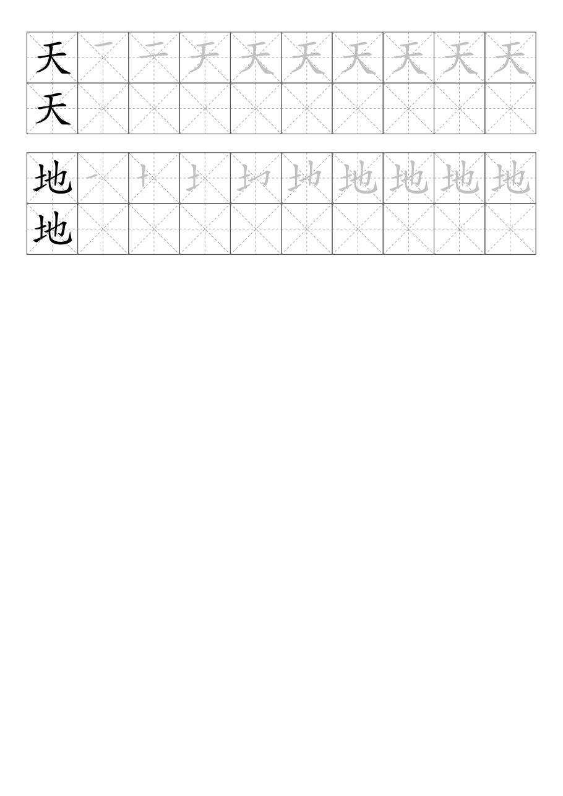

# zitie



给小学一年级练字用的米字格字帖生成器。输入一串汉字，输出 A4 PDF，直接打印。

每个字占两行：第一行把字按笔顺拆开，第二行留白让孩子自己写。

## 版面长什么样

一页 5 个字，每个字两行，每行 10 格。

第一行第 1 格是完整字头（黑色），从第 2 格起按笔顺逐笔累加。以「天」为例，依次是横、横加一横、横横撇，写完所有笔画后剩下的格子放完整字，供描红。笔顺格和描红格都是浅灰，只有字头是黑的。

第二行第 1 格还是黑色字头，其余 9 格全空，孩子照着写。两行紧贴，不留缝。

内容从页顶往下排，一页排不满就空着，不拉伸间距去凑满整张纸。

## 原理

字形不来自字体文件，而是来自 makemeahanzi 的笔画数据。这套数据是 hanzi-writer 那个网页笔顺动画库在用的，每个汉字被拆成一笔一条 SVG 路径，统一画在 1024×1024 的坐标里，y 轴向下，字身大约占中间 800 见方。

数据按字拆分后发布在 npm 包 hanzi-writer-data 里，脚本按需抓取单个字，例如 `https://cdn.jsdelivr.net/npm/hanzi-writer-data@2.0.1/天.json`，拿到后存进 `data/hanzi/` 缓存，之后离线可用。

路径到手以后，脚本把 M/L/Q/C/Z 指令解析成线段和贝塞尔曲线，二次贝塞尔（Q）换算成 PDF 支持的三次贝塞尔（C），再把 1024 坐标缩放进格子，用 pymupdf 的 Shape 逐笔填充。

每一笔都是独立的封闭路径，所以笔顺累加只是把 strokes 数组截取前 n 条，这是它和「字体加田字格模板」最大的区别：字体只能整字绘制，拿不到「只画前两笔」。

米字格本身是外框矩形加横竖中线、两条对角线，中线和对角线用虚线画。

## 当作 AI Skill 安装

这个仓库根目录有 `SKILL.md`，它本身就是一个 skill。把它克隆进 agent 的 skills 目录，之后不用记参数，直接说「给一年级出个字帖：人不在我是」，agent 就会调脚本生成 PDF。

```
git clone git@github.com:xieyan0811/zitie.git ~/.claude/skills/zitie
pip install pymupdf
```

CodeBuddy 用 `~/.codebuddy/skills/zitie`，GitHub Copilot CLI 用 `~/.copilot/skills/zitie`，别的 agent 换成各自的 skill 目录。

## 用法

```
pip install pymupdf
python3 src/make_zitie.py --chars 天地人你我他上下口
```

结果写到 `output/zitie.pdf`，同时生成 `output/zitie.png` 预览第一页。

常用参数：

`--chars` 要练的字，按顺序连写，例如 `天地人`。也可以写 `@生字表.txt` 从文件读，文件里可以换行、可以带空格。

`--cols` 每行几格，默认 10。

`--per-page` 每页几个字，默认 5。

`--size-mm` 格子边长，默认 19mm。10 列乘 19mm 正好等于 A4 可用宽度，再大就会溢出。

`--margin-mm` 上下页边距，默认 12mm。

`--inner-gap-mm` 同一个字的笔顺行和练习行之间的缝，默认 0（两行紧贴）。想要分开一点就调大。

`--group-gap-mm` 不同字之间的间距，默认 7mm。一页放不满时想凑满，把这个调大就行。

`-o` / `--out` 输出 PDF 的路径，默认 `output/zitie.pdf`。

`--preview` 预览 PNG 的路径，默认 `output/zitie.png`。

生成一整本生字表就这样：

```
python3 src/make_zitie.py --chars @生字表.txt --out output/第一单元.pdf
```

## 练自己的名字

名字只有两三个字，直接接在 `--chars` 后面就行：

```
python3 src/make_zitie.py --chars 张一鸣 -o output/名字.pdf
```

三个字会占页面上面前三组，下面留空。想多练几遍就把名字重复写几次，工具会按每页 5 个字自动分页：

```
python3 src/make_zitie.py --chars 张一鸣张一鸣张一鸣 -o output/名字.pdf
```

名字里的字往往比课本生字难，笔顺行正好能看出每一笔从哪起、到哪收。等孩子把笔顺行看熟，第二行那九格就是自己的练习量。

孩子刚学写名字那阵子，用这个比在作业本上反复写有效，因为每一笔的起笔位置都画在格子里，不用大人一直在旁边说「撇要长一点」。

## 目录

`src/make_zitie.py` 主脚本，全部逻辑都在这一个文件里。

`SKILL.md` skill 定义，装了之后可以让 agent 直接调用。

`data/hanzi/` 抓过的字数据缓存，可以整个删掉，下次运行自动重抓。

`output/` 生成的 PDF 和预览图。

## 已知限制

单个字的笔画数超过 9 时会截断，因为每行只有 10 格、第 1 格是字头。一年级生字笔画都在 9 划以内，暂时不会碰到；真要练笔画多的字，把 `--cols` 调大同时 `--size-mm` 调小就行。

数据覆盖常用汉字约九千个，生僻字（尤其繁体、异体）抓不到会直接报错退出，而不是悄悄留空。

没有拼音、部首、笔画数标注。要加拼音得另配一套带声调的字表；笔画数、部首这两个字段 makemeahanzi 的 dictionary.txt 里倒是有，缺的是拼音。

字的大小按统一的 1024 框缩放，不按每个字自己的外框撑满格子。好处是整页字号一致，代价是笔画少的字看着偏小（「口」就比较小）。如果改成按每个字的 bbox 撑满，不同字的大小会不一致，练字的参考性反而下降，所以没这么做。

字号由 `--fill-ratio` 控制，含义是字宽大概占格子的多少，默认 0.76。因为汉字普遍偏扁，这个值下字高只占六成半左右，四周留白接近两成；想要字再大就往上调，0.84 差不多是撑满的感觉。

摆放位置用的是常用字的平均字身中心，不是 1024 框的几何中心。这套数据里字身整体偏在框的下半部分（平均中心在 406 而不是 512），直接按框中心对齐会让每个字都往下沉一截。

## 许可

代码按 MIT 协议开源，见 LICENSE。

字形数据不在这份许可范围内。笔画数据来自 makemeahanzi 项目，由 hanzi-writer-data 打包分发，遵循 Arphic Public License，版权归原作者。`data/hanzi/` 只是运行时抓取的缓存，`.gitignore` 里已经排除，不要提交进仓库。
